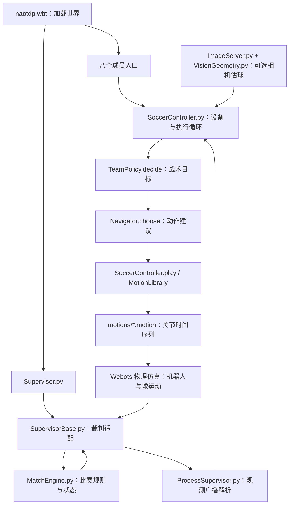

# Webots Robotics TDP

Webots 机器人足球开发工程。当前实现包含几何配置、部分裁判规则、共享角色策略、近球导航、关节动作、相机估球实验和测试工具。稳定四对四和真实硬件验证尚未完成。

## 环境要求与平台兼容性

**已验证的完整组合：Ubuntu 20.04.6 LTS（x86-64）＋Webots R2023b＋独立 Conda Python 3.10.22。** 当前世界入口为 `Wenao/worlds/naotdp.wbt`，足球仿真主流程不需要 ROS。

### 操作系统

下表区分 Webots R2023b 的官方系统支持和本项目的实际测试范围。仿真器支持某个平台，不代表本项目的依赖、控制器和测试工具已经在该平台验证。

| 操作系统 | Webots R2023b 官方支持 | 本项目状态 |
|---|---|---|
| Ubuntu 20.04 LTS，Intel/AMD 64 位 | 支持 | 已在 20.04.6 验证环境、世界加载、逻辑测试和相机检测；复现现有结果的基准平台 |
| Ubuntu 22.04 LTS，Intel/AMD 64 位 | 支持，同一版本提供对应安装包 | 本项目尚未实测，可作为后续兼容性测试平台 |
| Ubuntu 18.04 及更早版本 | 不在 R2023b 支持范围内 | 不作为本项目的运行环境 |
| Ubuntu 24.04、26.04 等更高版本 | R2023b 发布资料没有列为目标 Ubuntu 版本 | 尚未验证，不宣称兼容；新版 Webots 的系统支持不能直接套用于 R2023b |
| Windows 10 / 11，64 位 | 支持 | 可以安装原生 Webots 并尝试打开世界；本项目控制器、视觉依赖和自动测试尚未验证 |
| macOS 11 Big Sur / 12 Monterey | 支持；发布包覆盖 Intel 和 Apple Silicon | 可以安装原生 Webots并尝试打开世界；本项目尚未验证，Python 与依赖需匹配运行架构 |
| 更新的 macOS 版本 | R2023b 的固定版本系统说明未列出 | 尚未验证，不宣称兼容 |

系统范围依据 [R2023b 官方系统要求](https://github.com/cyberbotics/webots/blob/R2023b/docs/guide/system-requirements.md)；安装包与处理器架构依据 [R2023b 官方发布页](https://github.com/cyberbotics/webots/releases/tag/R2023b)。

### 软件与图形要求

- **Webots：R2023b。** 现有模型与实验结果以此版本为基准，其他版本需重新验证。
- **Python：独立 Conda Python 3.10 环境。** 已验证补丁版本为 3.10.22；Webots 的 Python command 指向该环境的解释器。
- **依赖：** NumPy 1.26.4、OpenCV 4.9.0.80、Ultralytics 8.1.4，见 `requirements-tested.txt`。视觉检测已验证组合另包含 PyTorch 2.2.2+cpu 和 torchvision 0.17.2+cpu；其他系统需使用对应平台的安装包，Ubuntu 的 CPU 安装命令不代表 macOS 安装方案。
- **图形：** Webots 3D 渲染要求支持 OpenGL 3.3 的图形设备与驱动；官方列出的最低图形内存为 512 MB。[官方硬件要求](https://github.com/cyberbotics/webots/blob/R2023b/docs/guide/system-requirements.md)
- **工程建议：** 四核 CPU、至少 8 GB 内存；同时运行八个控制器、视觉检测和开发工具时可采用 16 GB。此为配置建议，不是已测得的最低门槛，也不保证实时运行。
- **GPU 与 CUDA：** 已验证的视觉模型使用 CPU 推理，不要求 CUDA；Webots 的图形渲染仍需要正常工作的图形设备与驱动。

### Windows 与 macOS 的使用边界

当前文档中的 `env -u`、`dpkg-query`、Ubuntu 安装命令和 Linux 路径按 Ubuntu 编写，不能原样复制到 Windows。自动集成脚本 `tests/run_webots_check.py` 使用符号链接和 POSIX 进程组信号，在 Windows 上需要适配；macOS 的 Webots 可执行文件发现与依赖安装也尚未验证。

跨平台尝试可先通过原生 Webots 界面打开 `Wenao/worlds/naotdp.wbt`，设置独立环境的 Python command，再检查控制台是否有导入或控制器错误。WSL、虚拟机、容器和 Linux ARM64 均不在当前已验证范围。完整安装步骤见下方“安装复现步骤”，已执行的验证范围见 [验证状态](docs/VALIDATION.md)。

## Ubuntu 自动安装与启动

安装脚本适配 **原生 Ubuntu 20.04/22.04、Intel/AMD x86-64**；22.04 分支尚未实际验证。Windows、macOS、WSL、容器和其他 Ubuntu 版本不在脚本适配范围。

克隆后在项目根目录运行：

```bash
bash install.sh
```

脚本会检查或安装 Webots R2023b、独立 Conda Python 3.10 环境与固定 CPU 依赖，并执行逻辑测试。系统软件缺失时使用 sudo，整个脚本以普通账户运行。安装结束后，在 Webots 的 **Tools → Preferences → General → Python command** 中设置安装输出的解释器路径。

配置解释器后，在项目根目录启动：

```bash
bash launch.sh
```

启动器读取本机安装配置、设置环境 PATH，并打开 `Wenao/worlds/naotdp.wbt`，不要求提前手动激活 Conda。其他常用模式：

```bash
bash install.sh --dry-run                     # 预览安装计划
bash install.sh --check                       # 检查已有环境，不生成启动配置
bash install.sh --env-name webots-tdp-clean    # 使用另一个独立环境
```

完整参数、安装目录、重复执行行为和验证范围见 [docs/INSTALL.md](docs/INSTALL.md)。安装日志与启动路径存放在被 Git 忽略的 `.setup/`，不随公开源码上传。

入口：[安装](docs/INSTALL.md) · [运行](docs/RUN.md) · [系统架构与通信](docs/SYSTEM_ARCHITECTURE.md) · [验证状态](docs/VALIDATION.md) · [发布清理](docs/PUBLICATION_AUDIT.md) · [推送与分支排障](docs/GIT_PUSH_TROUBLESHOOTING.md) · [来源与许可](THIRD_PARTY_NOTICES.md)。

## 单人无摔倒进攻

激活环境后，在仓库根目录执行：

```bash
conda activate robotics-tdp
python tests/run_webots_check.py --attack --visible --diagnostics --seed 27 --output runs/single_player_next_01
```

该入口默认使用 guarded 调度，要求进球、无倾倒与恢复，并继续检查进球后停止的稳定性。标准站位已在约 76.24 仿真秒完成；镜像站位与球偏移场景也已完成严格验收。每次更换新的输出目录。具体方法与范围见 [单人稳定性说明](docs/SINGLE_PLAYER_STABILITY.md)。普通八人世界和四对四开发测试不属于本阶段单人验收范围。

## 仓库导览

首次四对四基线、门前瞄准目标调整和多人失稳排查见 [四对四调试记录](docs/MULTIPLAYER_DEBUGGING.md)，包含复现命令、结果与轨迹图。多人测试需显式记录执行模式；单人进球结果不代替对抗验证。

### 目录与文件用途

| 路径 | 作用 |
|---|---|
| [Wenao/worlds/naotdp.wbt](Wenao/worlds/naotdp.wbt) | **主仿真入口**：球场、足球、八个 NAO 模型、初始位置、控制器名称、视角与 40 ms 仿真步长 |
| [Wenao/protos/](Wenao/protos/) | Webots 场景与机器人模型；`CourseSoccerField.proto` 定义球场，`CourseGoal.proto` 定义球门，`NaoV6.proto` 为世界实际加载的机器人模型 |
| [Wenao/protos/meshes/](Wenao/protos/meshes/) / [textures/](Wenao/protos/textures/) | 模型网格、球衣、球网等外观资产；几何外观和碰撞/动力学配置需分别检查 |
| [Wenao/controllers/](Wenao/controllers/) | 球员、裁判、共享执行器、决策与视觉程序，详细职责见下方 |
| [Wenao/motions/](Wenao/motions/) | 预设关节角度与时间序列；包含行走、转向、侧移、踢球、传球和起身动作 |
| [tests/](tests/) | Python 逻辑检查、安装脚本检查，以及实际 Webots 几何、比赛、动作、视觉与连续进攻测试夹具 |
| [tools/evaluate_run.py](tools/evaluate_run.py) | 从单次实验的 JSONL 日志生成统计指标，用于分析动作尝试、策略变化、触球、球轨迹和恢复行为 |
| [tools/analyze_multiplayer_run.py](tools/analyze_multiplayer_run.py) | 关联各球员失稳过程、恢复命令与最近其他机器人位置；根节点接近不等于实际碰撞 |
| [verification/](verification/) | 脱敏后的历史实验结果、日志、图像和清单；`development/` 为开发试验，`publication/` 为发布整理后复测 |
| [docs/](docs/) | 安装、运行、验证缺口、部署状态和发布清理说明 |
| [ball_distance_results/visualisations.ipynb](ball_distance_results/visualisations.ipynb) | 历史测距数据分析、线性/多项式回归和随机森林实验；当前足球控制器不调用此 Notebook。所需 `data/final*.csv` 未随公开仓库提供，运行还需分析依赖，如 scikit-learn |
| [nao_ws/](nao_ws/) | 保留的 ROS/Gazebo 工作区；`src/nao` 为机器人相关包，`src/ros_gz` 为 ROS/Gazebo 桥接包，`src/sdformat_urdf` 为模型转换相关包。当前 Webots 足球主流程不依赖此目录，也未完成其独立运行验证 |
| [imgs/](imgs/) | 历史图片目录占位，目前仅有 `.gitignore`；实际验证图像位于 `verification/` |
| [install.sh](install.sh) / [launch.sh](launch.sh) | Ubuntu 环境安装与启动入口，使用方法见上方及 [安装说明](docs/INSTALL.md) |
| [requirements-tested.txt](requirements-tested.txt) / [requirements.txt](requirements.txt) | 前者固定已验证的直接依赖；后者保留原来的最低版本声明。自动安装优先采用前者，PyTorch CPU 版本由安装脚本另外固定 |
| [PROJECT_HISTORY.md](PROJECT_HISTORY.md) | 环境复现、修改、排障、失败实验和结果的独立技术记录 |
| [IMPLEMENTATION_NOTES.md](IMPLEMENTATION_NOTES.md) | 几何约定和实现变更的阶段性记录；当前验证范围以 `docs/VALIDATION.md` 为准 |
| [THIRD_PARTY_NOTICES.md](THIRD_PARTY_NOTICES.md) / [LICENSE](LICENSE) | 原项目出处、第三方作者与资产条款，以及仓库根许可证；不同资产的文件内条款保留 |
| [.gitignore](.gitignore) | 排除本机安装状态、运行数据、视觉日志、缓存和 Webots UI 偏好等生成文件 |

`Nao.proto`、`NaoH25V60.proto` 和 `NAOH25V60.urdf` 是保留的其他模型描述；当前世界引用 `NaoV6.proto`。场景中的部分背景和足球 PROTO 引用官方 R2023b 资源，首次加载需要可访问相应资源或已有 Webots 缓存。

### 八个球员入口

每队包含一个守门员、一个后卫和两个前锋。下列文件是 Webots 按控制器名称启动的入口，均转入共享的 `Base/SoccerController.py`；角色根据机器人名称确定，并非八套独立战术程序。

| 角色 | 红队入口 | 蓝队入口 |
|---|---|---|
| 守门员 | [RedGoalkeeper.py](Wenao/controllers/RedGoalkeeper/RedGoalkeeper.py) | [BlueGoalkeeper.py](Wenao/controllers/BlueGoalkeeper/BlueGoalkeeper.py) |
| 后卫 | [RedDefender.py](Wenao/controllers/RedDefender/RedDefender.py) | [BlueDefender.py](Wenao/controllers/BlueDefender/BlueDefender.py) |
| 前锋 A | [RedForwardA.py](Wenao/controllers/RedForwardA/RedForwardA.py) | [BlueForwardA.py](Wenao/controllers/BlueForwardA/BlueForwardA.py) |
| 前锋 B | [RedForwardB.py](Wenao/controllers/RedForwardB/RedForwardB.py) | [BlueForwardB.py](Wenao/controllers/BlueForwardB/BlueForwardB.py) |

### 决策、导航与动作执行

| 程序 | 负责的内容 |
|---|---|
| [Base/SoccerController.py](Wenao/controllers/Base/SoccerController.py) | **球员运行主循环**：创建设备、接收观测、检查比赛阶段和跌倒状态、调用决策与导航、播放动作、发送传球意图并记录日志 |
| [Utils/TeamPolicy.py](Wenao/controllers/Utils/TeamPolicy.py) | **战术决策**：`TeamPolicy.decide()` 根据比赛、机器人和球的状态选择追球者、阵型、支援、防守、守门、拦截、带球、传球或射门；`attack()` 选择目标球路与脚位目标 |
| [Utils/Navigation.py](Wenao/controllers/Utils/Navigation.py) | **移动与近球对齐**：`Navigator.choose()` 把战术目标转成动作名称；包含从预定球路后方接近、面向踢球方向、身体坐标下的侧移/后退、脚位对齐与到达位置滞回 |
| [Utils/HeadingFilter.py](Wenao/controllers/Utils/HeadingFilter.py) | 平滑 IMU 朝向，减少步态摇摆引起的反复转向，处理角度跨越 ±π 的情况 |
| [Utils/GuardedLocomotion.py](Wenao/controllers/Utils/GuardedLocomotion.py) | 单人 guarded 调度：直行周期末停步、非直行动作后收稳、IMU 与双脚受力的站姿稳定门槛；与 SoccerController 配合避免动态摇摆中反复对齐 |
| [Utils/MotionDiagnostics.py](Wenao/controllers/Utils/MotionDiagnostics.py) | 可选运动诊断：记录 IMU、动作实际播放时间、腿部目标/实测角和左右脚力；默认关闭，不选择动作或调整关节目标 |
| `SoccerController.py` 中的 `MOTION_FILES` / `MotionLibrary` | 把 `walk`、`shoot`、`pass` 等动作名映射到 `.motion` 文件；过滤模型中不存在的关节通道、按实际电机限位裁剪角度，并生成临时动作副本 |
| [Utils/ProcessSupervisor.py](Wenao/controllers/Utils/ProcessSupervisor.py) | 解析并验证裁判广播的 V2 JSON 观测，检查版本、数值、比赛状态与时间戳，保存最近有效观测；不是战术决策器 |

当前战术由规则、阈值和状态判断组成。YOLO 用于视觉检测，Notebook 用于历史测距实验；现有足球决策没有接入强化学习或已训练的战术模型。

`TeamPolicy` 返回 `Decision`：`behaviour` 是行为标签，`target` 是站位/对齐目标，`face` 是观察或预定球路目标，`kick` 指定踢球动作，`receiver` 指定接球者。`Navigation` 结合当前位置、朝向和球位置选择动作；`SoccerController` 再处理站稳、首段最短行走时长、比赛停止和恢复动作的优先级。

典型执行关系为 `SHOOT → 脚位对齐与站稳 → Shoot.motion`、`PASS → 传球对齐 → LongPass.motion`。`DRIBBLE` 当前主要通过面向球门的连续 `ForwardLoop.motion` 推进，不等于直接播放名为 dribble 的动作。`Sprint` 配置保留兼容用途，当前导航不会据此自动切换为更快步态。

### 裁判、几何与配置

| 程序或文件 | 负责的内容 |
|---|---|
| [Supervisor/Supervisor.py](Wenao/controllers/Supervisor/Supervisor.py) | 裁判入口；每个时间步更新比赛、广播观测、更新比分显示 |
| [Base/SupervisorBase.py](Wenao/controllers/Base/SupervisorBase.py) | Webots 裁判适配：读取球和机器人位置、估计球速与接触归属、执行放球/处罚/重置、记录比赛轨迹并广播观测 |
| [Utils/MatchEngine.py](Wenao/controllers/Utils/MatchEngine.py) | 独立于 Webots API 的比赛状态与部分规则逻辑：计时、半场换边、整球进球/出界、重启归属与限制等 |
| [Utils/CourseSpecs.py](Wenao/controllers/Utils/CourseSpecs.py) | 场地、球门、足球尺寸和时间步常量，以及整球穿越球门的几何判定 |
| [Utils/globalconfig.ini](Wenao/controllers/Utils/globalconfig.ini) | `[Match]` 配置比赛时间与种子，`[Controller]` 配置观测来源和视觉显示；旧的队伍/球员参数段保留给历史实现，不直接决定当前共享策略的站位 |
| [CourseSoccerField.proto](Wenao/protos/CourseSoccerField.proto) / [CourseGoal.proto](Wenao/protos/CourseGoal.proto) | 实际球场和球门的场景几何。尺寸调整需要同时核对 `CourseSpecs.py` 与场景模型 |

默认 `Observation=supervisor` 使用仿真真值开发战术。裁判具有场景重置与处罚摆放权限；球员控制器通过关节动作运动。裁判与测试夹具的摆放不作为自主走位能力的证据。完整 RoboCup 规则和行为性能仍未全部验证，具体缺口见 [VALIDATION.md](docs/VALIDATION.md)。

### 视觉与历史工具

| 程序或资产 | 作用与当前使用范围 |
|---|---|
| [Utils/ImageServer.py](Wenao/controllers/Utils/ImageServer.py) | 相机缓冲转换、异步 YOLO 检测、根据球框和相机 FOV 估计光轴深度/视线角、发布带采集信息的检测结果并保存视觉 CSV |
| [Utils/best.pt](Wenao/controllers/Utils/best.pt) | 随仓库保留的检测模型权重；用于球检测，不包含当前足球战术策略 |
| [Utils/VisionGeometry.py](Wenao/controllers/Utils/VisionGeometry.py) | 将相机估计结合采集时的机器人位姿、头部角度和假定外参转换为世界坐标；依赖直立姿态等假设，尚未完成多场景或真机标定 |
| [controllers/legacy/](Wenao/controllers/legacy/) | 原八个球员实现，供历史比较；当前世界不加载这些文件，它们不是可直接切换运行的新版入口 |
| [Utils/pathPlanning.py](Wenao/controllers/Utils/pathPlanning.py) / [Heuristics.py](Wenao/controllers/Utils/Heuristics.py) | 保留的 A* 网格规划与参考实现；当前共享控制器没有调用这两套 A*，现用导航采用局部目标避让 |
| [Utils/Functions.py](Wenao/controllers/Utils/Functions.py) / [Consts.py](Wenao/controllers/Utils/Consts.py) | 距离/角度辅助函数、时间步导出和旧动作封装；当前动作加载由 `SoccerController.MotionLibrary` 负责 |

`Observation=vision` 当前启用底部相机估球，但机器人定位仍来自 Supervisor，是混合实验模式。过期检测或丢球会停止移动；该模式不能作为独立视觉定位或真实机器人自主部署的证明。

### 运行时调用关系

完整的[系统架构与通信说明](docs/SYSTEM_ARCHITECTURE.md)包含纯文本整体架构图、单个球员调用链、视觉线程图和测试结构图。当前采用 Webots Controller API 连接仿真器、Emitter/Receiver 广播 UTF-8 JSON、普通 Python 函数连接决策与导航；可选视觉使用同进程线程、队列和锁，不依赖 ROS，也不运行独立图像网络服务器。



图中的决策与导航调用由 `SoccerController.act()` 组织。IMU、比赛状态和数据时效检查可优先中止普通动作；图示不表示策略模块直接调用 Webots 电机。

### 测试、日志与指标

| 入口 | 检查内容 |
|---|---|
| `python -m unittest discover -s tests -v` | 几何/A* 边界、消息与比赛逻辑、角色决策、导航、朝向过滤、视觉投影/CSV，以及安装脚本保护与启动环境隔离 |
| [tests/run_webots_check.py](tests/run_webots_check.py)，不加模式参数 | 世界加载、球门净尺寸、计分/重置和部分裁判执行检查，夹具为 `webots_course_check.py` |
| 同一入口 `--match` | 两个可配置半场的集成检查，夹具为 `webots_match_check.py`；默认 60 秒半场仅用于快速检查生命周期 |
| 同一入口 `--skills` | 独立的近距射门、带球、传球/接球物理夹具，使用 `webots_skill_check.py` |
| 同一入口 `--motions` | 隔离场景测量动作位移与实际转角，使用 `webots_motion_check.py` 和 `webots_motion_probe.py` |
| 同一入口 `--attack` | 一个实际球员控制器完成无对手的接近、推进和射门，使用 `webots_attack_check.py`；其他机器人使用旁站测试入口 |
| `--attack` 单人稳定性入口 | 默认 guarded 调度并执行无摔倒与进球后停止检查；用法、空间布局和验收条件见 [SINGLE_PLAYER_STABILITY.md](docs/SINGLE_PLAYER_STABILITY.md) |
| `--attack --side-transition phase` | 三次完整进攻均退化的实验候选，默认关闭、未采纳；保留复现入口，操作见 [ATTACK_TRANSITION_EXPERIMENT.md](docs/ATTACK_TRANSITION_EXPERIMENT.md) |
| 同一入口 `--transitions` | 固定动作衔接测量，每种三次；可用 `--transition-profile replay` 回放首次跌倒前的动作历史，比较有球/无球与站姿过渡；见 [TRANSITION_TESTS.md](docs/TRANSITION_TESTS.md) |
| 同一入口 `--vision` | 实际相机和随包检测模型的单场景检查，使用 `webots_vision_check.py` 和 `webots_vision_player.py`；必须指定新的 `--output` 目录 |
| [tools/evaluate_run.py](tools/evaluate_run.py) | 读取某次运行目录的日志，生成指标 JSON；动作计数是尝试次数，不能直接当作成功率 |
| `--attack --diagnostics` / `--match --diagnostics` | 在常规测试基础上每个时间步记录运动诊断，必须指定独立 `--output` 目录；操作见 [MOTION_STABILITY.md](docs/MOTION_STABILITY.md) |
| [tools/analyze_motion_diagnostics.py](tools/analyze_motion_diagnostics.py) | 汇总倾角超过 0.8 rad 的连续区间及其前一动作切换，辅助定位失稳；阈值区间不等于已验证的独立跌倒次数 |
| [tools/analyze_transition_run.py](tools/analyze_transition_run.py) | 按衔接测试组合汇总最大躯干倾角、偏航和低位倾倒观测；测试完成标记不代表稳定性通过 |

当前单人无摔倒进攻入口见 [SINGLE_PLAYER_STABILITY.md](docs/SINGLE_PLAYER_STABILITY.md)。早期带球滞回对照见 [DRIBBLE_OPTIMIZATION.md](docs/DRIBBLE_OPTIMIZATION.md)，中途跌倒的日志与实现限制见 [MOTION_STABILITY.md](docs/MOTION_STABILITY.md)。0.10/0.08 m 横向滞回候选已因退化撤回，导航仍保留原阈值；历史基线需显式使用 `--locomotion legacy` 复现。

自动 Webots 检查在临时项目中运行；部分模式用测试夹具替换裁判或球员入口，测量条件与正式比赛不同。具体命令、时长和成功标记见 [RUN.md](docs/RUN.md)。

以下目录在运行后生成，不属于公开源码的固定内容：

| 路径 | 生成内容 |
|---|---|
| `runs/` | `match-*.jsonl` 比赛状态、轨迹与裁判事件，`player-*.jsonl` 策略/导航变化、动作尝试和加载修正；自动测试另保存 `webots.log`、清单和结果 JSON。`TDP_RUN_DIR` 可选择其他输出目录 |
| `Wenao/controllers/Utils/vision_logs/` | 相机检测和距离/角度估计的 CSV |
| `.setup/` | 安装日志、环境解释器与 Webots 可执行文件的本机路径 |
| `Wenao/worlds/.naotdp.wbproj` | 本机视角、叠加显示等 Webots UI 偏好 |

这些生成文件已被 Git 忽略；公开测试快照集中于 `verification/`。保存日志与统计有助于定位失败，但不自动证明规则完整性、行为成功率或真机能力。

### 常见问题对应的代码位置

| 检查或修改目标 | 主要入口 |
|---|---|
| 仿真场景、初始位置、模型或 controller 名称 | `naotdp.wbt` 与 `protos/` |
| 选择追球、射门、传球、支援或守门策略 | `TeamPolicy.py` |
| 接近球、绕到球后、转向振荡、侧移和脚位对齐 | `Navigation.py`、`HeadingFilter.py`，以及 `SoccerController.act()` |
| 步行/踢球动作本身缓慢、偏航或不稳定 | `.motion` 资产、`MOTION_FILES` / `MotionLibrary`、`--motions` 测量；播放速度与 Webots 快进倍率不同 |
| 比赛计时、换边、出界重启或计分 | `globalconfig.ini`、`MatchEngine.py`、`SupervisorBase.py`、`CourseSpecs.py` |
| 球检测、相机测距、估计过期 | `ImageServer.py`、`VisionGeometry.py`、`SoccerController.visual_world()` |
| 实验是否实际有效、指标如何解释 | `tests/`、`evaluate_run.py`、`verification/` 与 `docs/VALIDATION.md` |

下方为完整技术过程记录，独立副本见 [PROJECT_HISTORY.md](PROJECT_HISTORY.md)。

## 配置、实现与调试记录

历史记录日期：2026-10-13；单人稳定性更新：2026-10-20。项目目录名称：`Webots_Robotics_TDP`。

本文记录环境配置、场景复现、模型与控制修改、失败实验、验证结果和待完成事项。早期完整安装终端记录未全部保存，安装命令属于按已确认环境重建的复现步骤。测试结果依据保存的 JSON、日志与场景图像。

## 1. 当前状态

- 仿真世界：`Wenao/worlds/naotdp.wbt`。
- 运行环境：Ubuntu 20.04.6、Webots R2023b、Conda Python 3.10.22。
- 主流程：Webots Controller API、共享 Python 策略、预设关节动作与 Supervisor 裁判。
- 默认观测：Supervisor 真值；可选相机估球模式仍依赖 Supervisor 定位。
- 无对手连续进攻的旧基线为 147.16 秒且发生恢复；guarded 单人入口已在 76.24 秒完成无倾倒、无恢复的严格验收，详见上方单人稳定性说明。
- 可靠四对四、快速稳定步态、完整比赛规则、独立定位和真实硬件部署尚未完成。

本文陈述实现与实验事实，不将单次夹具成功等同于总体性能验收。

## 2. 工程结构与来源

```text
Webots_Robotics_TDP/
├── README.md
├── PROJECT_HISTORY.md
├── IMPLEMENTATION_NOTES.md
├── THIRD_PARTY_NOTICES.md
├── LICENSE
├── requirements.txt
├── requirements-tested.txt
├── install.sh
├── launch.sh
├── Wenao/
│   ├── worlds/naotdp.wbt
│   ├── protos/
│   ├── controllers/
│   └── motions/
├── tests/
├── tools/
├── docs/
├── verification/development/
├── ball_distance_results/
└── nao_ws/
```

来源与署名集中见 [THIRD_PARTY_NOTICES.md](THIRD_PARTY_NOTICES.md)。原项目 Git 历史保存在公开目录外；发布快照使用新的本地历史。`nao_ws/` 是保留的 ROS/Gazebo 工作区，当前足球主流程没有启用它。

## 3. 环境版本

| 项目 | 实际版本 |
|---|---|
| Ubuntu | 20.04.6 LTS |
| Webots | R2023b，包版本2023b |
| Python | 3.10.22 |
| 环境 | Conda，名称robotics-tdp |
| NumPy | 1.26.4 |
| OpenCV | 4.9.0.80 |
| Ultralytics | 8.1.4 |
| PyTorch | 2.2.2+cpu |
| torchvision | 0.17.2+cpu |

系统Python未替换。模型权重 `Wenao/controllers/Utils/best.pt` 保留原内容。

## 4. 安装复现步骤

以下命令适用于新环境；已有正常运行的环境无需重建。完整初始安装记录未保留，因此不能将以下命令视为原始终端逐字记录。

从仓库父目录进入项目：

```bash
cd Webots_Robotics_TDP
```

建立独立Python环境：

```bash
conda create -n robotics-tdp python=3.10 pip -y
conda activate robotics-tdp
python --version
command -v python
```

安装已验证的CPU依赖组合：

```bash
python -m pip install --index-url https://download.pytorch.org/whl/cpu torch==2.2.2 torchvision==0.17.2
python -m pip install -r requirements-tested.txt
python -m pip check
```

直接依赖已经固定；传递依赖和Python构建并非完整锁定。原始requirements只给最低版本，直接安装可能得到不同组合。原安装说明漏掉了pip的install子命令，现有命令已修正。

Webots R2023b可从 [官方发布页](https://github.com/cyberbotics/webots/releases/tag/R2023b) 获取。下载Ubuntu安装包后，以实际路径替换示例：

```bash
sudo apt-get install /path/to/webots_2023b_amd64.deb
command -v webots
dpkg-query -W -f='${Version}\n' webots
```

Miniconda和Webots的初始下载日志没有完整保存；当前版本和实际运行记录已经确认。

## 5. 启动世界与配置解释器

```bash
conda activate robotics-tdp
env -u PYTHONPATH -u PYTHONHOME -u LD_LIBRARY_PATH -u QT_PLUGIN_PATH -u QT_QPA_PLATFORM_PLUGIN_PATH PYTHONNOUSERSITE=1 webots Wenao/worlds/naotdp.wbt
```

环境清理仅作用于本次进程，避免继承其他Python、ROS或Qt路径。

Webots的Python command应使用以下命令输出的可执行文件路径：

```bash
python -c "import sys; print(sys.executable)"
```

设置需要指向python文件，而非仅指向bin目录。控制台Starting controller后的解释器可用于确认实际路径。`controller`模块由Webots提供，普通终端的导入失败不能作为安装同名PyPI包的依据。

首次打开保持暂停，检查资源加载、八个球员和Supervisor，再开始运行。原始证据显示九个控制器均已启动、仿真时钟推进、机器人位置变化；这只证明运行链路建立。

## 6. 原版运行中的诊断现象

| 现象 | 含义与处理 |
|---|---|
| Starting controller信息 | 进程启动信息，不能证明行为有效 |
| LHand/RHand not found | 动作文件包含当前模型没有的通道；原版忽略通道，后续加载器过滤并记录 |
| Ball Distance/Angle连续打印 | Supervisor调试数据，不是视觉准确率证明 |
| 黑色摄像头叠加框 | 暂停、设备未启用或无新图像时可能出现；可关闭UI叠加显示 |
| 重载前保存弹窗 | 保存会改变磁盘世界；恢复已保存初始条件时使用Close without Saving |
| 暂停与退出 | 暂停用于观察，关闭窗口用于结束；自动测试脚本处理Ctrl+C并保存已有输出 |
| 画面模糊 | 与视角、纹理和图像分辨率有关，不能单凭画面推断GPU状态 |

Webots渲染、物理/控制计算与YOLO推理是不同任务。CPU版PyTorch不表示Webots未使用GPU渲染。601.08秒仿真曾用约427秒墙钟时间，平均约1.4倍实时；快进不会自动增加每秒仿真时间内的机器人位移。

原版由规则/状态机、A*、局部避障、YOLO/OpenCV与关节动作组成，没有完成足球决策学习系统。

## 7. 几何配置与原版差异

| 参数 | 当前值 |
|---|---:|
| 球场长×宽 | 9×6 m |
| 边界带 | 1 m |
| 地面长×宽 | 11×8 m |
| 球门净宽×净高×深度 | 2.6×1.2×0.6 m |
| 球门区 | 1×3 m |
| 罚球区 | 2×5 m |
| 罚球点距球门线 | 1.5 m |
| 中圈外径 | 1.5 m |
| 足球半径 | 0.07 m |
| 步长 | 40 ms |

原球场白线内长宽已有9×6 m，主要差异是球门、场线区域、边界和初始姿态。原球模型半径接近现值，明确错误之一是视觉球直径0.48 m。

新增本地CourseSoccerField与CourseGoal，主世界引用本地模型；原周边碰撞墙移除，球员直立从场内阵型开始，最终门框为白色。Webots安装资源没有被修改。

整球判定要求向外穿过x=±4.57 m，并在插值越线位置检查球完全通过门宽和横梁。仅球心过线、返回场内或从横梁上方通过不算进球。

球质量、摩擦、回弹与NAO6质量/惯量尚未完成独立标定。

## 8. 工具、视觉和模型修正

- 权重路径改为相对ImageServer.py定位。
- 视觉球直径统一为0.14 m，焦距由相机宽度和实际FOV计算。
- 图像转换匹配BGRA缓冲，队列、线程初始化和CSV混合字段处理修正。
- A*统一0.1 m网格、[y,x]数组索引、起点到终点路径顺序；当前共享导航不调用旧A*角色代码。
- 旧IMU朝向与当前坐标系不一致且pitch轴关闭，曾使直立机器人误入恢复；现为躯干对齐并启用相关轴。
- 动作加载器过滤缺失通道，裁剪到模型电机限位，站立从当前目标角度过渡。

原CSV/线程/队列部分问题最初来自静态风险检查，不能写成原版每项都曾实际报错。后续测试覆盖修正逻辑。

## 9. 当前控制结构

| 模块 | 职责 |
|---|---|
| CourseSpecs | 尺寸与整球几何 |
| MatchEngine | 比赛阶段、时间、换边、重开与部分规则 |
| SupervisorBase | 仿真裁判适配、接触近似、处罚、广播和轨迹 |
| ProcessSupervisor | V2 JSON验证与状态保存 |
| TeamPolicy | 角色、追球权、带球、传球、射门、守门 |
| SoccerController | IMU、接收、动作加载与执行 |
| HeadingFilter | 环绕角度平滑 |
| Navigation | 接近、身体坐标调整、连续推进和站位滞回 |
| ImageServer/VisionGeometry | 带时间与姿态的检测和球估计 |

八个球员入口共用SoccerController；原角色文件存于legacy，作为对照而非新版独立入口。

## 10. 裁判、观测与部署限制

阶段包括INITIAL、READY、SET、PLAYING、STOPPED、PREPARE、HALFTIME、FINISHED。规则实现覆盖初始开球队/方向、换边、整球出界、部分重开与计分限制、静止球、非法站位、重启距离以及长期倒地/场外移除。

完整推搡、阻挡、手球、持球、禁区人数、牌罚、罚球、换人、暂停与赛事流程尚未完成。

生产流程使用updateMatch而非旧兼容判球方法。重开由状态机组织；测试的半场摆阵型不代表正式比赛中的自主换边。

广播version=2包含球、机器人、时间、比赛和处罚。无效/非有限数据被拒绝，保留上次有效状态。接触点归属是近似，同时接触仍有歧义。

pass_intent记录发送者、接球者和超时，接球者接应、传球者让出追球权。Webots通信尚未替换成真实网络。

默认观测为Supervisor真值；vision模式仅将相机估球接入决策，定位仍来自Supervisor。丢球或过期会停止。投影使用采集时姿态和头部角度，并假设躯干直立。

真实固件、SDK、机载部署、独立定位、网络和硬件适配尚未验证。NAOqi/libqi仅为候选接口。

## 11. 早期验证

逻辑检查从参数阶段扩展到23、25、32，最后为33个。现存证据保留早期23个与最终33个日志，数量不等于行为成功率。

几何、整球判定、非法站位和重启距离场景通过。基础物理夹具分别检查近距射门、带球位移和接球者触球。

实际底部相机/YOLO静止球场景：置信度约0.926、平面误差约0.01003 m。仅一个场景，不是完整相机或真机标定。

## 12. 60秒半场问题

最初开发测试为60秒半场、READY2秒、SET1秒、静止球30秒重开。121.04秒完成，比分0:0；球轨迹0.07566 m，没有触球归属转换。

首次重开四名前锋被移到场边，换边后八个球员来不及返回合法半场，共12次开球站位移除。60秒配置可以检查生命周期，但不足以观察慢步态完整比赛。

max_displacement可包含裁判摆放，不能当真实行走能力。

## 13. 测试时长与放球修正

加入half-seconds、ready-seconds、stuck-seconds、reset-formation、visible和timeout参数。检查退出码、完成标记和异常，并保存控制台输出；中断会停止进程。

放球分离阈值从0.5 m改为0.25 m，避免误移球后0.3 m的合法开球队员；对手距离限制独立执行。

120秒半场、READY10秒、静止球120秒、半场夹具摆阵型的复测：241.08秒完成，PLAYING约218秒，零站位移除，球轨迹6.539 m，14次触球归属转换，3次pass/2次dribble尝试，0:0，20次恢复尝试。

实验时长、夹具和控制同时变化，不能单独归因于算法。一次新裁判检查曾读取step更新前的位置而失败，同步步骤修正后通过；退出码不能代替完成标记。

## 14. 300秒半场基准

300秒半场、READY45秒、静止球120秒、seed27、半场夹具摆阵型：601.08秒完成，PLAYING约460秒，球轨迹12.763 m，24次触球归属转换，22次恢复尝试，0:0。

全部球员连续走路片段中位数0.44秒，两名前锋约0.54/0.56秒。SHOOT意图转换15次，实际shoot动作0次；pass2次、dribble4次。近球的小目标点、到点与朝向条件造成反复调整。

## 15. 动作实测

| 动作 | 观察窗 | 实际结果 |
|---|---:|---|
| ForwardLoop | 8 s | 前进0.682 m，约0.085 m/s |
| Forwards50 | 8 s | 前进0.435 m，约0.054 m/s |
| Sprint | 8 s | 前进0.298 m，约0.037 m/s；偏航约-61° |
| Backwards | 8 s | 后退约0.273 m |
| 左/右侧移 | 各8 s | 约0.102/-0.178 m |
| 左/右转10 | 各4 s | 约4.45/-16.19° |
| 左转20/40 | 各4 s | 约16.87/38.83° |
| 右转20/40 | 各4 s | 约-17.35/-16.40° |

转向观察窗不等于动作文件时长。Shoot约4.8 s、LongPass约3.299 s、Forwards50约6.76 s、左转180约9 s。测量为单次模拟值，不是硬件或统计标定。

当前导航固定使用已测连续步行，Sprint不作为速度开关。右转大角度分段使用右转20，避免仅按文件名选择。

## 16. 导航改写与配对复测

近球导航改为从球后方接近、面向预计球路、身体坐标侧移/后退、射门前站稳和持续带球。角色站位采用滞回，行走启动后设置0.96秒最小时长，安全与停止条件优先；后续循环尚未按支撑相位保护切换。共同last_touch暂保追球权，CLEAR朝前。

| 指标 | 基准 | 导航版本 |
|---|---:|---:|
| 连续walk片段中位数 | 0.44 s | 1.36 s |
| 恢复动作尝试 | 22 | 16 |
| 球路径 | 12.763 m | 14.757 m |
| 触球归属转换 | 24 | 36 |
| pass尝试 | 2 | 12 |
| shoot尝试 | 0 | 0 |
| 比分 | 0:0 | 0:0 |

同一时长/种子的配对改善部分效率，但未形成可靠攻击。该轮发生在最后射门时机修改之前，不证明最终战术整场已验证。

## 17. 连续攻击失败与修正

单人攻击夹具：初始机器人约[0.5,-0.15,0.334]，球约[1.2,0,0.07]；其余机器人旁站，随后只用关节动作移动。

旧规则在进攻方向x>1.8 m就射门，但已测近距射门只推动球约0.4 m。180秒内仅到球x约3.546 m，未进球，实验明确失败并保留日志。

改为朝球门开口最近可用点带球，距目标小于0.5m再射门。最终147.16秒完成整球进门，球末位置约[4.578,-0.781,0.070]，仅RedForwardA接触。

最终基础夹具结果：近距射门推进0.406 m并越线，带球最大位移约1.045 m，接球者触球。33个逻辑检查与裁判回归通过。

连续攻击成功仅覆盖一个无对手场景，速度仍慢。最后射门策略尚未整场复测。

## 18. 连续攻击耗时

按动作启动到下一动作或结束的日志估算，含初始化：

| 动作 | 时间 | 次数 |
|---|---:|---:|
| walk | 55.80 s | 24 |
| 左右侧移 | 59.28 s | 39 |
| 普通转向 | 13.92 s | 9 |
| recover_back | 6.80 s | 2 |
| shoot | 8.48 s | 2 |
| stand | 4.48 s | 5 |

此表不是精确技能完成时间，恢复命令不等于完整跌倒统计。

## 19. 安装脚本比较

另有一个外部安装脚本，面向Ubuntu22.04、venv和相同Webots/Python基线，完成系统包、固定依赖、模型加载检查与启动入口生成。

对原始源文件只有两项修正：ImageServer权重路径改为相对目录，WorldInfo步长设为40 ms；另外生成九个runtime.ini。该安装流程不包含现有几何、判球、导航与进攻修改。下载哈希检查和黑图YOLO推理不构成足球行为验证。

## 20. 当前复测命令

所有output目录必须新建命名，历史目录不能混用。命令在仓库根目录、robotics-tdp环境中执行。

```bash
python -m unittest discover -s tests -p 'test_*.py'
python tests/run_webots_check.py --output runs/new_geometry_01
python tests/run_webots_check.py --skills --visible --output runs/new_skills_01
python tests/run_webots_check.py --attack --visible --output runs/new_attack_01
python tests/run_webots_check.py --motions --visible --output runs/new_motions_01
python tests/run_webots_check.py --vision --output runs/new_vision_01
```

较长四对四开发观察：

```bash
python tests/run_webots_check.py --match --half-seconds 300 --ready-seconds 45 --stuck-seconds 120 --reset-formation --visible --seed 27 --output runs/new_match27_01
python tools/evaluate_run.py runs/new_match27_01 --output runs/new_match27_01/metrics.json
```

完成标记分别为COURSE_CHECK_OK、SKILL_CHECK_OK、ATTACK_CHECK_OK、MOTION_CHECK_OK、VISION_CHECK_OK和MATCH_CHECK_OK，含义取决于各测试门槛。

默认match测试仍为60秒半场、READY2秒、静止30秒，只适合生命周期检查。reset-formation仅在半场开始摆阵型，不算自主换边；seed主要改变方向/开球队，并非完整随机场景。

正式默认配置半场600秒、启动120秒、READY45秒、SET5秒，首次PLAYING约在170秒；READY/SET计入半场时钟。默认配置也不表示完整规则已验收。

## 21. 指标与证据解释

| 字段 | 含义与限制 |
|---|---|
| commands | 动作尝试而非成功 |
| decision_transitions | 策略意图而非动作实际播放 |
| contact_transitions | 接触近似的last_touch转换 |
| ball_path_metres_sampled | 排除记录到的裁判放球，不等于净向球门推进 |
| robot_path_metres_sampled | 含躯干摆动，不是标定速度 |
| fallen_removal_penalties | 长期倒地处罚，不是全部跌倒 |
| setup_removals | 开球非法站位移除 |
| fixture_formation_count | 测试摆放次数 |
| median_walk_bout_seconds | walk片段中位数 |
| command_seconds_all_phases | 含等待阶段的命令时间估算 |

manifest保存环境、种子和历史源码散列。发布证据已脱敏并标记，原实验散列不代表当前整理后的文件。单人attack采用几何进球判定，不执行正式计分流程，scored结果与正式goals字段不同。

公开精选证据位于[verification/development](verification/development/README.md)。原始运行目录和未经处理的日志在公开目录外保存。

## 22. 后续验证与优化

- 降低近球横向调整次数，带球和射门采用独立容差，检验滞回。
- 改善动作切换过渡，减少恢复和重新接近。
- 开发更快且经过偏航/平衡/接触测量的步态。
- 扩大初始位置、偏移、朝向和球速；同场景单变量对比。
- 逐级进入传接球、一对一、四对四与视觉实验。
- 标定NAO6物理参数、相机外参、球摩擦/回弹和真实控制接口。

将同一场景从147秒降到100秒以内属于开发目标，尚未实现。稳定进球、最终策略整场复测、完整裁判、独立定位和真机迁移仍未完成。

## 23. 关联资料

- [运行说明](docs/RUN.md)
- [验证状态](docs/VALIDATION.md)
- [部署状态](docs/DEPLOYMENT_STATUS.md)
- [实现说明](IMPLEMENTATION_NOTES.md)
- [发布清理记录](docs/PUBLICATION_AUDIT.md)
- [第三方来源和许可](THIRD_PARTY_NOTICES.md)
- [初期证据](verification/development/README.md)
- [时长问题证据](verification/development/test-timing/README.md)
- [导航与攻击证据](verification/development/navigation/README.md)

后续实验记录应包含日期、源码版本、配置、初始条件、命令、成功门槛、输出目录、失败情况和结论。建议与尚未执行工作均应明确标记。
