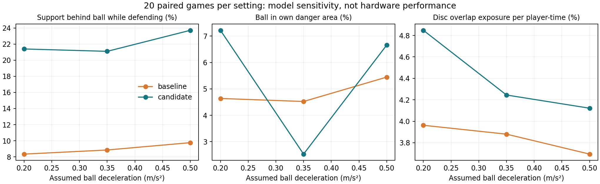

# 学长机制提取：2026-10-25 验证记录

本轮保留现有Webots工程，以学长项目的实验分层、控球相关支援线为设计参考。具体范围与运行命令见 [使用说明](../../docs/ALUMNI_TRANSFER_EXPERIMENTS.md)。

## 二维主实验与敏感性

主实验：seed 27–36，每个seed分别让RED/BLUE使用候选，共20场；两半场各300秒，READY 10秒，dt 0.2秒。两种球模型敏感性各20场，其他条件与主实验一致。源文件散列记录在各目录manifest中，主实验原始源码另存 [快照](primary/source_snapshot/)。

| 公共球减速度（假设） | 候选胜/平/负 | 候选/对照：防守时支援者实际在球后比例 | 候选/对照：球在己方危险区比例 | 候选/对照：圆盘重叠暴露人秒 |
| --- | --- | --- | --- | --- |
| 0.35 m/s²，主实验 | 1 / 18 / 1 | 21.10% / 8.85% | 2.53% / 4.52% | 1891.0 / 1728.6 |
| 0.20 m/s²，敏感性 | 0 / 20 / 0 | 21.39% / 8.34% | 7.22% / 4.64% | 2158.6 / 1764.6 |
| 0.50 m/s²，敏感性 | 1 / 18 / 1 | 23.71% / 9.76% | 6.66% / 5.45% | 1831.8 / 1641.8 |

数据：[主实验汇总](primary/summary.json)、[逐场结果](primary/games.json)、[减速度0.2](friction-02/summary.json)、[减速度0.5](friction-05/summary.json)。

结论：候选增加了回撤覆盖，但净胜球没有整体改善；危险区域指标随模型假设反转，拥堵指标持续增加。**不采用为默认策略**。不能用覆盖比例上升替代比赛质量提升，也没有证明统计显著。

同seed交换候选队是相关样本。`null-control`的6次运行实际上是3个布局各重复两次标签，用于自检，不是6个独立实验。两组使用完全相同baseline时，轨迹与汇总对称；对应测试还逐步核对观测和事件。

指标含义：危险区为球队方向下ball.x<-2.5 m；支援覆盖只在对手距离优势超过0.20 m的SUPPORT时段统计。圆盘重叠暴露逐对累加到参与球员，同队一对可贡献两个人秒，不是实际身体接触时长或跌倒次数。上述时长/比例均属模型测量。

## 默认行为和单人三维回归

- [历史决策重放](default-policy-replay.json)：与改动前Git版本比较21,704个决策，默认输出完全一致。
- [实际三维基线对齐](default-dynamics-comparison.json)：与原完整基线共有2,713个裁判采样点，机器人根节点位置最大差为0，比赛状态差异为0；不声称比较了全部关节轨迹。
- [本轮实际单人结果](single-regression.json)：标准布局76.24模拟秒进球；恢复0次，最大躯干倾角约0.3881 rad，最低高度约0.2877 m，包含进球后1.6秒停止检查。
- 这些是有限回归证据，不是所有布局或对抗条件的成功率。

## 三维四对四

两半场各300秒，READY 45秒，SET/半场停顿为开发夹具短时长，seed 27，guarded执行，半场开始摆放测试阵型，诊断开启。基线与单队候选均已完成。

| 指标 | 基线 | 仅RED采用候选 |
| --- | --- | --- |
| 完成时刻 | 601.08 s | 601.08 s |
| 比分RED:BLUE | 0:0 | 0:1 |
| PLAYING累计 | 508.04 s | 462.00 s |
| 恢复命令 | 5 | 14 |
| 每PLAYING分钟恢复命令 | 0.591 | 1.818 |
| 倾角超0.8 rad连续过程 | 4 | 10 |
| 根节点间距<0.30 m的球员对采样累计 | 41.00 s | 74.04 s |

数据：[三维基线](webots-baseline/)、[三维候选](webots-candidate-red/)、[自动对照与配置核验](webots-comparison.json)。核验通过：种子、赛程、执行模式、源文件、动作和夹具相同；实际球员命令中仅红队标记为possession，蓝队始终baseline。不同角色仍按各自分支运行，候选实际只改非追球前锋支援目标。

根节点位置首次采样差异在50.80 s出现，属于RedForwardA。候选场BLUE在238.20 s进球。进球改变了之后的比赛阶段和轨迹，两场有效比赛时间不同，不能把每次额外恢复都直接归因于回撤目标或某一种动作。

**决定：拒绝将当前候选设为默认。** 没有运行更多三维种子或交换候选队来寻找有利结果；本轮一个条件下的退化足以阻止推广，但不证明所有控球相关支援设计都无效。下一轮需先隔离角色路径/占位、追球者让位和解围后接触场景，保持失败候选供复现。

## 工程检查

[逻辑检查记录](logic-tests.json)：已有66项与本轮新增12项，共78项通过。新增覆盖二维重复性、模型滚动/阻挡、整球判定复用、脚下球离开后的踢空、错传队友与对手拦截区分、两种进攻方向及候选隔离。新比较工具还在实际两场完整三维数据上通过配置与结果核对。

## 验证边界

二维不验证物理摔倒、完整感知或NAO6硬件。相同源码与配置不代表底层数值执行必然跨机器完全一致。正式软件许可、允许的状态来源、硬件接口和课程验收范围仍以导师确认与实际测试为准。

本轮工具和代码有辅助开发，不将这些产物直接归属为某位成员已独立完成的课程贡献。
