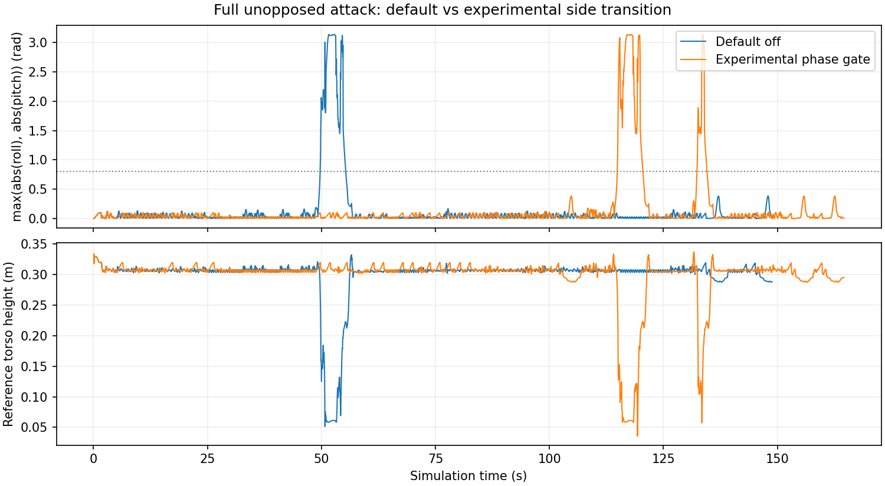

# 完整进攻中的站姿过渡候选：未采纳

2026-10-20，Webots R2023b，Conda Python 3.10，种子 27。一次关闭候选的基线复测与三次开启候选的实际单人进攻，均从独立进程启动。候选默认关闭，保留开关用于复现失败实验。

| 条件 | 进球用时 | 倾角越界区间 | 恢复命令 | 完成的过渡 |
|---|---|---|---|---|
| 基线 off，一次复测 | 147.16 s | 1 | 2 | 0 |
| 候选 phase，三次各自相同 | 162.92 s | 2 | 3 | 16 |

候选的过渡等待合计 19.20 s，进球用时比基线增加 15.76 s，约 10.7%。侧移命令时长由 59.28 s 减少至 46.80 s，但整体性能退化，因此未采纳。三次重复用于确认该固定夹具的可复现性，不证明普遍成功率。

候选首次越界发生在 SHOOT 状态下的左侧移脚位对齐，而非正在播放射门动作；第二次越界发生在重新追球后的侧移。分别在约 115.12–119.84 s、132.64–133.76 s 观察到低位且非直立的采样，辅助确认实际失稳。姿态阈值区间与起身尝试仍不能直接当成独立跌倒计数。

## 文件

- `summary.json`：四次运行的关键指标、样本区间与限制。
- `baseline_01-*` / `candidate_01-*` / `candidate_02-*` / `candidate_03-*`：实际进攻结果、原有指标、运动诊断摘要、过渡事件和匿名 manifest。
- `candidate-failure-windows.json`：候选两段失稳附近的逐帧运动数据。
- `full-attack-comparison.png`：首轮候选与本轮基线的原始 IMU 阈值和裁判参考躯干高度；欧拉角变化不直接代表角速度。

对照中所有控制器源文件 SHA256 一致，候选模式分别记录为 off 和 phase；动作、导航、战术、世界和模型参数未改变。运行日志与原始 manifest 的本机路径保留于忽略的 runs 目录，发布证据省略这些路径。54 项逻辑检查通过，物理行为对照未达到改进标准。

复现方式与下一轮隔离窗口见 [ATTACK_TRANSITION_EXPERIMENT.md](../../docs/ATTACK_TRANSITION_EXPERIMENT.md)。完整对抗、独立视觉定位与真实硬件性能仍未验证。
