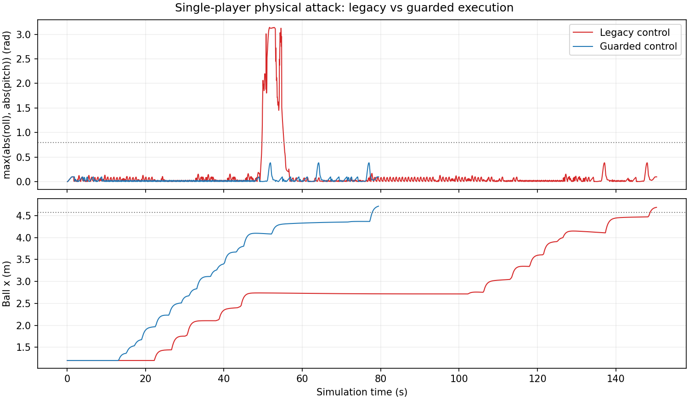

# 单人无摔倒进球验收

2026-10-20，Webots R2023b、Python 3.10，独立进程、种子 27。最终版本五次测试均同时通过整球进球、无倾倒、无恢复，以及进球后 1.6 秒停止观察。所有进攻运动均由真实球员控制器播放关节动作完成，没有在进攻期间移动球或机器人。

| 最终布局 | 次数 | 进球仿真时间 | 恢复命令 | 最大躯干倾角 |
|---|---|---|---|---|
| 标准初始站位 | 3 | 每次 76.24 s | 每次 0 | 约 22.23° |
| 机器人初始 y 镜像 | 1 | 129.04 s | 0 | 约 22.23° |
| 足球初始 y 偏移 +0.25 m | 1 | 161.16 s | 0 | 约 22.23° |

原始 legacy 控制器的负对照仍在 147.16 秒进球，但出现两次恢复、最低躯干高度约 0.051 m，被同一严格条件正确判为失败。标准 guarded 场景的侧移动作尝试由原基线 39 次减少为 2 次；动作文件的播放时长、机器人质量、摩擦和整球进球条件未放宽。

## 修正与失败记录

guarded 模式在直行实际周期末停步，单次非直行动作结束后先收稳，确认 IMU 与双脚受力稳定后再计算脚位，所有新动作从起点播放。它是稳定性门槛下的动作调度，未实现全身平衡控制，也未扩大原侧向对齐容差。

开发第一版已在标准站位无摔倒进球，但镜像站位在 180 s 时球中心停于 x=4.556 m，未达到 x=4.57 m 的整球条件，因此失败。最终版将 guarded 的瞄准点从门线上移至球门内部 0.30 m，保持原射门触发距离按门线计算，镜像站位随后完成进球。开发失败记录保留于 `development_mirrored_line_target-*`，不将无摔倒但未进球计为成功。

## 文件与复现范围

- `summary.json`：最终五次对照、开发失败、旧版负对照与检查数量。
- `standard_01/02/03-*`、`mirrored_01-*`、`offset_01-*`：进攻结果、常规指标、IMU 摘要与匿名 manifest。
- `legacy_negative-*`：旧版在严格验收中的预期失败。返回非零表示验收条件拒绝其跌倒行为，非测试工具崩溃。
- `development_mirrored_line_target-*`：瞄准点仍位于门线上的开发版本失败结果。
- `single-player-comparison.png`：标准场景的原始 IMU 阈值量与球 x 坐标；上图为欧拉角数值，不直接代表角速度，下图虚线为整球所需的球心位置。

最终五次的球员控制器源码 SHA256 相同，测试布局分别记录在 manifest 中。开发阶段与负对照使用各自记录的旧源码版本，不与最终版本混淆。本机解释器路径与完整日志仅保留在忽略的 runs 目录，发布 manifest 省略本机路径。

严格条件为：进球且 RedForwardA 有触球、躯干 up 不低于 cos(0.8)、高度不低于 0.20 m、恢复命令为 0，包含停止观察。五次有限条件通过不构成通用成功率，也不代表四对四、独立视觉定位或真机通过。63 项逻辑检查通过。操作见 [SINGLE_PLAYER_STABILITY.md](../../docs/SINGLE_PLAYER_STABILITY.md)。
