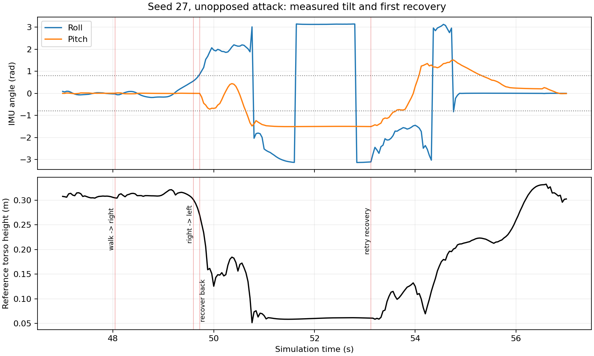

# 单人进攻运动诊断

2026-10-13，Webots R2023b，固定种子 27，无对手进攻，开启可选运动诊断。147.16 s 进球，进攻结果与原基线相同；运动采样 3719 次。此记录定位现有失稳，未修改步态、导航或起身策略。

右侧移结束前已产生侧倾；49.72 s 首次超过 0.8 rad 阈值时，roll 约 49.1°，pitch 约 -0.30°，随后执行向后起身。两次恢复尝试发生在同一连续越界区间。相关性不证明动作切换或起身方向是唯一原因。

- `motion-summary.json`：倾角越界区间、前一动作切换、脚力和关节误差。
- `first-fall-window.json`：47–57 s 的原始诊断采样与切换快照。
- `first-fall.png`：IMU 与裁判参考躯干高度；位置广播与 IMU 采样时间可能存在一步差异。
- `attack-result.json` / `metrics.json`：进攻结果与常规统计。
- `source-manifest.json`：测试模式、种子、诊断开关和源码校验值，省略本机路径。

脚力采用传感器局部坐标系，未经支撑状态标定。倾角区间不是已验证的跌倒计数，关节误差不是因果证明，固定种子单场不能证明通用成功率。操作与后续隔离实验见 [MOTION_STABILITY.md](../../docs/MOTION_STABILITY.md)。

图中 IMU 为原始欧拉角；±π 处的数值回绕及大 pitch 姿态下的欧拉角变化，不代表身体发生瞬时角度跳变。
