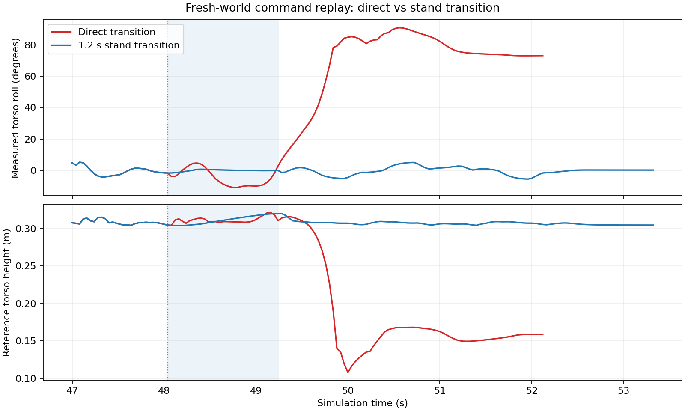

# 动作衔接与历史回放测量

Webots R2023b，固定种子 27，2026-10-13。共保留 47 项有效对照：33 项短动作测量、12 项完整动作历史回放、2 项全新世界复核。共享比赛控制器、导航、战术策略和动作资源未修改；站姿过渡只在测试安排中使用。

## 结果

短动作的 11 种组合各三次，均未出现低位倾倒观测，最大空间倾角约 5.6–7.0°。单独改变起始播放相位或切换侧移方向，没有复现原来的跌倒。

| 完整历史回放，世界内重置 | 低位倾倒观测 / 测量数 | 最大躯干倾角范围 |
|---|---|---|
| 原始球位，直接切换 | 1 / 3 | 9.49–90.89° |
| 原始球位，加入 1.2 s 站姿过渡 | 0 / 3 | 9.34–16.65° |
| 球移至远处，直接切换 | 3 / 3 | 91.45° |
| 球移至远处，加入站姿过渡 | 0 / 3 | 16.96° |

同一世界内的重置不等于从全新世界启动。完整历史的第二、三轮有球直接切换未跌倒，虽然命令和播放相位一致，身体轨迹出现差异。因此上述比值仅描述实际观测，不能解读为通用成功率。

单独启动全新 Webots 进程复核原始球位：直接切换出现侧倒，最大空间倾角 90.89°；加入过渡未出现侧倒，最大空间倾角 9.37°。

直接回放的 1203 个采样至原始 49.72 s，与进攻基线的 IMU、参考位置完全一致。过渡回放的 1161 个采样至 48.04 s 也完全一致，之后才插入站姿动作；校验见 `prefix-comparison.json`。图中蓝色背景为过渡执行区间；两种安排后续动作时刻不同。

结果支持：失稳与完整运动历史及身体状态有关，足球接触并非该回放失稳的必要条件。站姿过渡值得进入完整进攻回归测试；现有结果不证明其可直接用于所有侧移切换，也未验证进球、整体用时或真机性能。

## 数据与方法修正

- `isolated-result.json` / `isolated-summary.json`：33 项有效短动作对照。
- `replay-result.json` / `replay-summary.json`：四种完整历史对照，各三次。
- `fresh_direct-*` / `fresh_stand-*`：全新进程各一次的结果及统计。
- `transition_fresh_*-window.json`：全新对照从 47 s 起的运动诊断窗口。
- `source-manifests.json`：相应运行的源码、夹具、动作资源校验值与参数，省略本机解释器路径。

最初 `transition_isolation_01` 因测试回执通信失败中断；普通收发器共享 PROTO channel 字段，状态重置后改变了接收通道。已改用独立 `super_emitter`，失败运行不计入对照。

早期 `transition_isolation_02` 的尾段没有显式停止尚在播放的独立动作。其三个独立动作的旧数据共九项已被 `transition_isolation_stop_01` 的九项重新测量替换；其余八种组合在尾段之前已经完成最后一次侧移，保留原有 24 项测量。两次运行的实际版本分别保存在 manifests 中，不将合并结果冒充同一次运行。

低位倾倒定义为至少三个采样满足躯干高度小于 0.20 m、up 小于 0.5，不要求连续；最大空间倾角为 acos(up)。它们是诊断指标，不是独立跌倒计数或裁判判罚。停止播放后保持目标的尾段也参与测量。脚力为传感器局部坐标值，参考位置来自裁判广播；回放停用了自动恢复和战术决策。操作见 [TRANSITION_TESTS.md](../../docs/TRANSITION_TESTS.md)。
